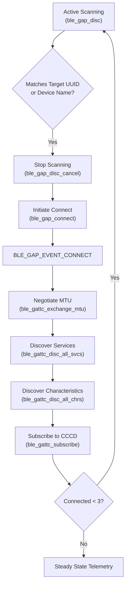

# NimBLE Multi-Device BLE Central Skill

This skill provides step-by-step procedures for managing simultaneous BLE Central / GATT Client connections to at least 3 external equipment devices using the native ESP-IDF Apache NimBLE stack.

---

## 1. Stack Configuration Checklist

1. Ensure the following symbols are active in `sdkconfig.defaults`:
   ```ini
   CONFIG_BT_ENABLED=y
   CONFIG_BT_BLE_ENABLED=y
   CONFIG_BT_NIMBLE_ENABLED=y
   CONFIG_BT_NIMBLE_ROLE_CENTRAL=y
   CONFIG_BT_NIMBLE_ROLE_OBSERVER=y
   CONFIG_BT_NIMBLE_MAX_CONNECTIONS=4
   CONFIG_BT_NIMBLE_MAX_BONDS=4
   CONFIG_BT_NIMBLE_MAX_CCCDS=16
   ```

---

## 2. Peer Table Architecture

Maintain an internal peer tracking array sized to `BLE_MAX_SIMULTANEOUS_CONNECTIONS`:

```c
typedef struct {
    uint16_t conn_handle;
    uint8_t  addr[6];
    int8_t   rssi;
    bool     connected;
    bool     services_discovered;
    uint16_t notify_val_handle;
    char     device_name[32];
} ble_peer_device_t;
```

---

## 3. Connection & Discovery Lifecycle



### 3.1. Active Scanning
*   Start scanning when free slots exist in `s_connected_peers`:
    ```c
    struct ble_gap_disc_params disc_params = {
        .filter_duplicates = 1,
        .passive = 0,
        .itvl = BLE_SCAN_INTERVAL_MS * 1000 / 625,
        .window = BLE_SCAN_WINDOW_MS * 1000 / 625,
    };
    ble_gap_disc(BLE_OWN_ADDR_PUBLIC, BLE_HS_FOREVER, &disc_params, ble_gap_event, NULL);
    ```

### 3.2. Connecting Without Congestion
*   **Rule**: Always cancel discovery (`ble_gap_disc_cancel()`) immediately before initiating a connection (`ble_gap_connect()`) to prevent NimBLE controller scheduler starvation.

### 3.3. Discovery & CCCD Subscription
*   After MTU exchange completion, trigger service and characteristic discovery.
*   Subscribe to the notification characteristic by writing `0x0001` to its CCCD (Descriptor `0x2902`) using `ble_gattc_write_flat()`.

---

## 4. Decoupled Event Handling (Critical Rule)

*   **CRITICAL**: NimBLE callbacks run in the NimBLE Host Task context.
*   **NEVER** perform blocking calls, JSON formatting, or network I/O in the GATT notification callback.
*   **Handoff Pattern**:
    ```c
    static int ble_on_notify(uint16_t conn_handle, const struct ble_gatt_error *error,
                             struct ble_gatt_attr *attr, void *arg) {
        if (attr != NULL && attr->om != NULL) {
            ble_telemetry_packet_t packet;
            packet.conn_handle = conn_handle;
            packet.len = OS_MBUF_PKTLEN(attr->om);
            os_mbuf_copydata(attr->om, 0, packet.len, packet.data);
            packet.timestamp_ms = esp_log_timestamp();

            // Push to FreeRTOS queue with zero delay
            xQueueSendToBack(s_telemetry_queue, &packet, 0);
        }
        return 0;
    }
    ```

---

## 5. Disconnection & Reconnection Strategy

1. On `BLE_GAP_EVENT_DISCONNECT`:
   - Locate the peer slot by `conn_handle`.
   - Clear peer handles and mark slot as disconnected.
   - Release any pending GATT client resources.
2. If total active connections < `BLE_MAX_SIMULTANEOUS_CONNECTIONS`:
   - Restart scanning with exponential backoff (1s, 2s, 4s, up to 30s) to avoid thrashing the radio.
