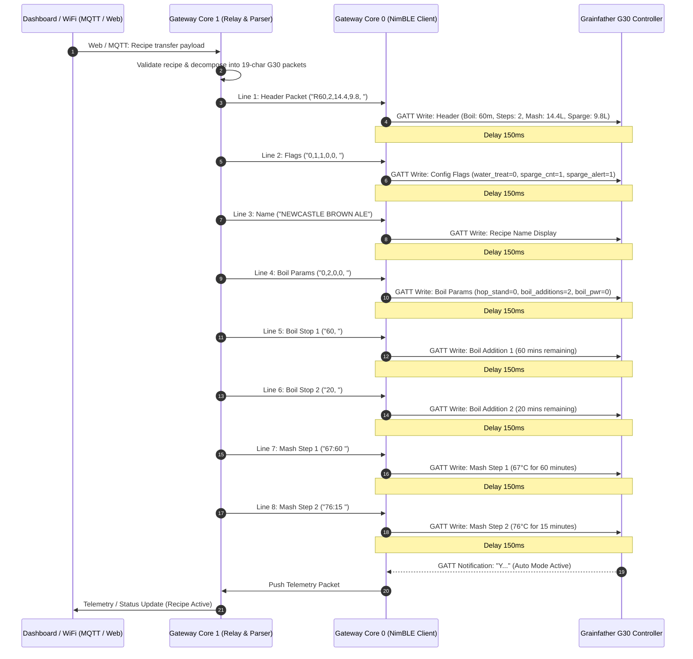
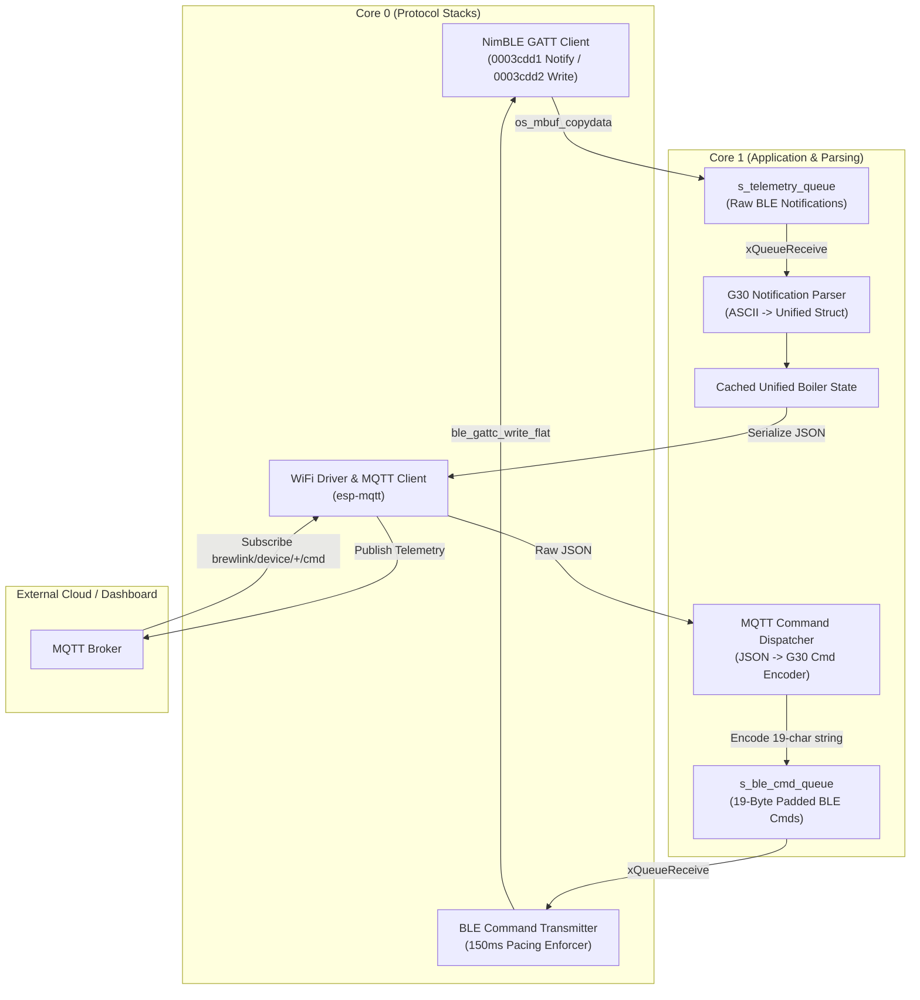

# Grainfather G30 BLE Communication Skill

This skill provides comprehensive instructions, protocol specifications, data schemas, and ESP-IDF / NimBLE code patterns for establishing resilient, bidirectional Bluetooth Low Energy (BLE) communication between the **BrewLink Gateway** (Adafruit HUZZAH32 ESP32) and the **Grainfather G30 Connect** brewing controller.

---

## 1. Device Profile & BLE Specifications

The Grainfather G30 Connect controller utilizes a custom USR-BLE UART-based GATT service to broadcast state updates and receive commands.

### 1.1. Advertising & GATT Identifiers
* **Advertised Device Name**: Begins with `Grain` (typically `Grain`, `Grainfather`, or `Grain_XXXX`).
* **Primary Service UUID**: `0000cdd0-0000-1000-8000-00805f9b34fb` (128-bit)
* **Read / Notification Characteristic UUID**: `0003cdd1-0000-1000-8000-00805f9b0131` (128-bit)
  * Properties: `NOTIFY`, `READ`
  * Client Characteristic Configuration Descriptor (CCCD): `0x2902`
* **Write Characteristic UUID**: `0003cdd2-0000-1000-8000-00805f9b0131` (128-bit)
  * Properties: `WRITE`, `WRITE_NO_RSP`

### 1.2. Protocol Framing & Pacing Invariants
1. **Fixed 19-Character Command Length**:
   Every command string transmitted to the Write Characteristic (`0003cdd2-...`) **MUST be exactly 19 ASCII characters long**.
   If a command string is shorter than 19 bytes, it must be padded with ASCII spaces (`0x20`, `' '`).
   * **Rule**: Never transmit trailing null characters (`\0`), carriage returns (`\r`), or newlines (`\n`) over the BLE link.
2. **Write Pacing & Debounce**:
   The G30 controller processor requires a minimum delay of **100 ms to 150 ms** between successive write commands. Bursting commands faster than 100 ms will result in dropped packets or controller lockup.
3. **CCCD Subscription**:
   Notifications on characteristic `0003cdd1` must be enabled immediately after characteristic discovery by writing `0x0001` to its CCCD (`0x2902`).

---

## 2. Command Reference Dictionary (WiFi -> BLE / Gateway -> G30)

All outbound commands are encoded into fixed 19-character ASCII buffers.

| Function | Command Code | Example String (Padded to 19 Chars) | Description |
| :--- | :--- | :--- | :--- |
| **Set Target Temp** | `$XX,` or `$XX.X,` | `"$65.0,            "` | Sets target temperature in °C. Trailing comma is required. |
| **Increment Temp** | `U` | `"U                  "` | Increments target temperature by 1°C. |
| **Decrement Temp** | `D` | `"D                  "` | Decrements target temperature by 1°C. |
| **Toggle Heat** | `H` | `"H                  "` | Toggles heating element on/off. |
| **Heat On** | `K1` | `"K1                 "` | Explicitly enables heating element. |
| **Heat Off** | `K0` | `"K0                 "` | Explicitly disables heating element. |
| **Toggle Pump** | `P` | `"P                  "` | Toggles recirculation pump on/off. |
| **Pump On** | `L1` | `"L1                 "` | Explicitly enables pump. |
| **Pump Off** | `L0` | `"L0                 "` | Explicitly disables pump. |
| **Set Timer** | `Sx` | `"S60                "` | Sets active timer to `x` minutes. |
| **Pause / Resume Timer** | `G` | `"G                  "` | Toggles timer pause / run state. |
| **Cancel Timer** | `C` or `C0` | `"C                  "` | Cancels the active countdown timer. |
| **Press "Set" Button** | `T` | `"T                  "` | Simulates physical SET button press on controller. |
| **Interaction Complete**| `I` | `"I                  "` | Acknowledges active prompt (e.g. grain added, sparge done). |
| **Dismiss Boil Alert** | `A` | `"A                  "` | Dismisses boil addition / hop warning. |
| **Dismiss Sparge Alert**| `V` | `"V                  "` | Dismisses sparge water alert. |
| **Delayed Heating** | `Bx,y,` | `"B30,0,             "` | Sets delayed heating timer (`x` minutes, `y` seconds). |
| **Query Boil Temp** | `M` | `"M                  "` | Requests current boil temperature setpoint. |
| **Query Firmware** | `X` | `"X                  "` | Requests controller firmware version string. |
| **Cancel / Quit Session**| `Q1` | `"Q1                 "` | Cancels active brew session and returns to idle. |
| **Disconnect Manual** | `Q0` | `"Q0                 "` | Disconnects manual mode without cancelling session. |
| **Disconnect Auto** | `Q2` | `"Q2                 "` | Disconnects auto mode without cancelling session. |

---

## 3. Recipe Transfer Protocol (`R` Command Sequence)

Transferring an automated brew recipe from the Gateway / Dashboard to the G30 requires a coordinated sequence of 19-byte commands spaced by at least 150 ms.

### 3.1. Recipe Transmission Sequence Diagram



### 3.2. Complete Recipe Transmission Sequence & Master Controller Rule
The G30 Connect controller expects multi-line recipe parameters in strict sequence:
1. **Line 1 (Main Header)**: `R{boil_time_min},{mash_step_count},{mash_water_l},{sparge_water_l},` (e.g. `"R60,2,14.4,9.8,    "`)
2. **Line 2 (Configuration Flags)**: `"0,1,1,0,0,         "` (water treatment alert=0, sparge counter=1, sparge alert=1, delayed=0, skip start=0)
3. **Line 3 (Recipe Name)**: Uppercase alphanumeric name, truncated to 19 characters, space padded (e.g. `"NEWCASTLE BROWN ALE"`)
4. **Line 4 (Boil Parameters)**: `"{hop_stand_min},{boil_addition_count},0,0,"` (e.g. `"0,2,0,0,           "`)
5. **Lines 5..4+N (Boil Addition Stops)**: Time remaining in minutes with trailing comma in descending order (e.g. `"60,                "`, `"20,                "`)
6. **Lines 4+N+1.. (Mash Steps)**: Mash temperature and duration in `{temp_c}:{duration_min}` format (e.g. `"67:60              "`, `"76:15              "`)

> **Master Controller Rule**:
> * **Do not question the recipe**: BrewLink must faithfully upload the recipe parameters without questioning or overriding them.
> * **G30 Controller is Master**: Once the recipe sequence (`R...`) is transmitted (`auto_mode == true`), the Grainfather G30 hardware controller is the sole master of the brewing process.
> * **Passive Monitoring & User Acknowledgements Only**: BrewLink must wait for mash setpoints to be reached, await mash step timers, wait for boil temperature to be reached, await the boil timer, and forward user acknowledgements (`T`, `I`, `A`, `V`) when prompted by the G30.
> * **No Own Timers or Steps**: BrewLink must **never** send its own countdown timers (`S{x}`, `C`) or manual temperature steps (`$XX,`) while a recipe process is ongoing (`auto_mode == true`).

---

## 4. Notification Reference & Parsing (BLE -> WiFi / G30 -> Gateway)

The G30 Controller pushes ASCII notification strings on characteristic `0003cdd1`. Each notification starts with a single uppercase letter prefix:

### 4.1. Notification Prefixes

| Prefix | Name | Payload Format | Example | Parsed Information |
| :---: | :--- | :--- | :--- | :--- |
| **`X`** | Temperatures | `X{TargetTemp},{CurrentTemp}` | `X65.0,64.8` | Target Setpoint: 65.0°C<br/>Current Temperature: 64.8°C |
| **`Y`** | Hardware & Stage | `Y{Heat},{Pump},{Auto},{Ramp},{InterMode},{InterCode},{Stage},{Delayed}` | `Y1,1,0,0,0,0,1,0` | Heat: ON (1)<br/>Pump: ON (1)<br/>Auto Mode: OFF (0)<br/>Ramping: NO (0)<br/>Interaction: NONE (0)<br/>Code: 0<br/>Stage: 1 (Mash)<br/>Delayed: OFF (0) |
| **`T`** | Timer State | `T{Active},{LeftMin},{TotalMin},{LeftSec}` | `T1,45,60,59` | Timer Active: YES (1)<br/>Ceiling Minutes Remaining: 45<br/>Total Minutes: 60<br/>Seconds in Minute: 59 (`44:59` total remaining) |
| **`W`** | Output & Flags | `W{PwrPct},{Paused},{StepMash},{Interrupted},{ManualPwr},{SpargeAlert}` | `W100,0,1,0,0,0` | Heat Power: 100%<br/>Timer Paused: NO (0)<br/>Step Mash: YES (1)<br/>Interrupted: NO (0)<br/>Manual Mode: NO (0)<br/>Sparge Alert: NO (0) |
| **`I`** | Interaction Prompt | `I{InteractionCode}` | `I2` | Interaction Required: Code 2 (e.g., "Add Grain / Sparge Complete") |
| **`C`** | Boil Temperature | `C{BoilTemp}` | `C100.0` | Calibrated Boiling Point: 100.0°C |
| **`E`** | Error Alert | `E{ErrorCode}` | `E1` | Controller Error Code: 1 |

### 4.2. Interaction Codes (`InterCode` in `Y` / `I{code}`)
* `0`: Normal operation / Idle.
* `1`: Add mash water prompt (`"Add mash water & Press SET to start heating"`, G30 LCD: `"Add X.XL water, press set to continue"`).
* `2`: Strike temperature reached prompt (`"Strike temperature reached: Add grain"`, G30 LCD: `"Add Grain"`).
* `3`: Mash step complete / Sparge alert (`"Mash step finished: Sparge alert"`, G30 LCD: `"Mash finished / Sparge alert"`).
* `4`: Sparge stage with sparge counter (`"Sparge: Add sparge water & Press SET to skip to boil"`, G30 LCD: `"SPARGE — Set to skip to boil"`).
* `5`: Boil addition alert (`"Boil addition alert: Add timed hops/adjuncts"`).
* `6`: Cooling stage prompt (`"Boil finished: Start cooling"`).

### 4.3. Controller Brew Phase (`Stage` in Notification `Y`)

The 7th parameter in the `Y` notification represents the controller's active brew stage (`1..N` for mash steps, where initial strike water fill and Add Grain occur within `Stage == 1`):

| Controller Stage | Brew Phase Name | Condition / Telemetry State | Display Name |
| :---: | :--- | :--- | :--- |
| **0** | Idle | Controller not running a recipe | `"Idle"` |
| **1** | Strike Water Fill | `InterCode == 1` or pre-heat (`!heat_active && !ramp_active && !timer.active`) | `"Add Strike Water"` |
| **1** | Strike Water Ramp | `InterMode == 0 && ramp_active == 1 && !timer.active` | `"Heating Strike Water"` |
| **1** | Add Grain | `InterMode == 1 && InterCode == 2` | `"Add Grain"` |
| **1** | First Mash Step | `InterMode == 0 && ramp_active == 0` (`timer.active == 1`) | `"Mash Step 1"` |
| **2** | Second Mash Step | Programmed mash step 2 (`Stage == 2`) | `"Mash Step 2"` |
| **$N$** | Mash Step $N$ | Programmed mash step $N$ (`Stage == N`) | `"Mash Step N"` |
| **Sparge** | Sparge / Skip to Boil | `InterMode == 1 && (InterCode == 3 || InterCode == 4)` | `"Sparge"` |
| **Boil Ramp**| Heating to Boil | $T_{\text{target}} \ge 98.0^\circ\text{C}$ and (`ramp_active == 1` or heating to setpoint) | `"Heating to Boil"` |
| **Boil** | Boiling | $T_{\text{target}} \ge 98.0^\circ\text{C}$ and `ramp_active == 0` (or `InterCode == 5`) | `"Boiling"` |
| **Cooling** | Counterflow Chilling | `InterMode == 1 && InterCode == 6` | `"Cooling"` |

### 4.4. Timer Telemetry & Operational States

1. **Ramping Phase**:
   When ramping to a mash step or boil setpoint, the controller sets `ramp_active = true` but keeps `timer.active = false`. The UI/telemetry must present the scheduled step duration with state `Heating to Setpoint` (`starts at temp`).
2. **Active Countdown**:
   Once target temperature is reached, the G30 controller beeps and initiates the countdown. The `T` notification (`T{Active},{LeftMin},{TotalMin},{LeftSec}`) reports 1-based ceiling minutes remaining (`LeftMin`), total step minutes (`TotalMin`), and the seconds component within the minute (`LeftSec`, `0..59`, e.g., for a 2-minute step: `T1,2,2,59..0` for `01:59..01:00`, followed by `T1,1,2,59..0` for `00:59..00:00`). BrewLink computes `remaining_seconds = ((LeftMin - 1) * 60) + LeftSec` when `LeftMin > 0` and `total_seconds = TotalMin * 60`.
3. **Paused State**:
   Timer pause is signaled via the 2nd field of the `W` notification (`W{PwrPct},{Paused},...`). Outbound command `G` toggles the pause/resume state.

---

## 5. Unified Data Schemas (BrewLink Multi-Equipment Architecture)

To ensure the G30 seamlessly operates alongside fermenters, chillers, and future equipment, telemetry and commands are mapped to the **BrewLink Unified Schema**.

### 5.1. Equipment Category Taxonomy
```c
typedef enum {
    EQUIPMENT_TYPE_UNKNOWN       = 0,
    EQUIPMENT_TYPE_BOILER        = 1, // G30, BrewZilla, Braumeister
    EQUIPMENT_TYPE_FERMENTER     = 2, // Conical fermenters, Tilt, Plaato
    EQUIPMENT_TYPE_COOLER_HEATER = 3  // Glycol chillers, heating wraps
} equipment_type_t;
```

### 5.2. Unified Boiler State Schema (C Struct)
```c
typedef struct {
    float    current_temp_c;
    float    target_temp_c;
    float    boil_temp_c;
    bool     heat_active;
    uint8_t  heat_power_pct;        // 0 to 100%
    bool     pump_active;
    bool     auto_mode;
    bool     ramp_active;
    struct {
        bool     active;
        bool     paused;
        uint32_t remaining_seconds;
        uint32_t total_seconds;
    } timer;
    struct {
        uint8_t  current_step;
        char     step_name[24];     // e.g. "Mash In", "Saccharification", "Boil"
    } stage;
    struct {
        bool     required;
        uint8_t  code;
        char     message[48];       // User-readable instruction
    } interaction;
    uint32_t last_updated_ms;
} unified_boiler_state_t;
```

### 5.3. Outbound Telemetry JSON (BLE -> WiFi / MQTT)
Published to `brewlink/device/{MAC_ADDRESS}/telemetry` (QoS 0):
```json
{
  "device_id": "001A22334455",
  "equipment_type": "boiler",
  "model": "Grainfather G30",
  "rssi": -68,
  "state": {
    "temperature": {
      "current_c": 64.8,
      "target_c": 65.0,
      "boil_c": 100.0
    },
    "heating": {
      "active": true,
      "power_pct": 100,
      "ramping": false
    },
    "pump": {
      "active": true
    },
    "timer": {
      "active": true,
      "paused": false,
      "remaining_seconds": 2700,
      "total_seconds": 3600
    },
    "stage": {
      "auto_mode": true,
      "step_index": 1,
      "step_name": "Mash Step 1"
    },
    "interaction": {
      "required": false,
      "code": 0,
      "prompt": ""
    }
  },
  "timestamp_ms": 1420500
}
```

### 5.4. Inbound Command JSON (WiFi / MQTT -> BLE)
Received from `brewlink/device/{MAC_ADDRESS}/cmd` (QoS 1):
```json
{
  "req_id": "cmd-8921",
  "action": "set_pump",
  "params": {
    "state": true
  }
}
```
Available `action` verbs:
* `"set_pump"`: `{"state": true|false}`
* `"set_heat"`: `{"state": true|false}`
* `"set_target_temp"`: `{"temp_c": 67.5}`
* `"set_timer"`: `{"duration_min": 60}`
* `"pause_timer"`: `{}`
* `"resume_timer"`: `{}`
* `"cancel_timer"`: `{}`
* `"ack_interaction"`: `{}`
* `"press_set"`: `{}`
* `"dismiss_alert"`: `{}`
* `"cancel_session"`: `{}`
* `"load_recipe"`:
  ```json
  {
    "recipe": {
      "name": "Czech Pilsner",
      "boil_time_min": 75,
      "mash_water_l": 16.5,
      "sparge_water_l": 14.0,
      "mash_steps": [
        {"temp_c": 52.0, "duration_min": 15},
        {"temp_c": 65.0, "duration_min": 45},
        {"temp_c": 75.0, "duration_min": 10}
      ],
      "boil_additions_min": [60, 15]
    }
  }
  ```

---

## 6. Dual-Core Bidirectional Architecture & Workload Partitioning



---

## 7. Implementation Code Patterns (C / ESP-IDF)

### 7.1. Zero-Allocation Notification Parser
```c
#include "esp_err.h"
#include <stdio.h>
#include <stdlib.h>
#include <string.h>

esp_err_t g30_parse_notification(const uint8_t *data, size_t len, unified_boiler_state_t *state) {
    if (data == NULL || len == 0 || state == NULL) {
        return ESP_ERR_INVALID_ARG;
    }

    char buf[64];
    size_t copy_len = len < (sizeof(buf) - 1) ? len : (sizeof(buf) - 1);
    memcpy(buf, data, copy_len);
    buf[copy_len] = '\0';

    char prefix = buf[0];
    const char *payload = &buf[1];

    switch (prefix) {
        case 'X': { // X{Target},{Current}
            float target = 0.0f, current = 0.0f;
            if (sscanf(payload, "%f,%f", &target, &current) == 2) {
                state->target_temp_c = target;
                state->current_temp_c = current;
            }
            break;
        }
        case 'Y': { // Y{Heat},{Pump},{Auto},{Ramp},{InterMode},{InterCode},{Stage},{Delayed}
            int heat = 0, pump = 0, auto_m = 0, ramp = 0, inter_m = 0, inter_c = 0, stage = 0, del = 0;
            if (sscanf(payload, "%d,%d,%d,%d,%d,%d,%d,%d",
                       &heat, &pump, &auto_m, &ramp, &inter_m, &inter_c, &stage, &del) >= 6) {
                state->heat_active = (heat == 1);
                state->pump_active = (pump == 1);
                state->auto_mode = (auto_m == 1);
                state->ramp_active = (ramp == 1);
                state->interaction.required = (inter_m == 1);
                state->interaction.code = (uint8_t)inter_c;
                state->stage.step_index = (uint8_t)stage;
                g30_resolve_interaction_message(state, state->interaction.code);
            }
            break;
        }
        case 'T': { // T{Active},{LeftMin},{TotalMin},{LeftSec}
            int active = 0, left_min = 0, tot_min = 0, left_sec = 0;
            int count = sscanf(payload, "%d,%d,%d,%d", &active, &left_min, &tot_min, &left_sec);
            if (count >= 3) {
                state->timer.active = (active == 1);
                state->timer.total_seconds = (uint32_t)(tot_min * 60);
                if (count == 3) {
                    state->timer.remaining_seconds = (uint32_t)(left_min * 60);
                } else if (left_min > 0 && left_sec < 60) {
                    state->timer.remaining_seconds = (uint32_t)(((left_min - 1) * 60) + left_sec);
                } else {
                    state->timer.remaining_seconds = (uint32_t)left_sec;
                }
            }
            break;
        }
        case 'W': { // W{PwrPct},{Paused},{StepMash},{Interrupted},{ManualPwr},{SpargeAlert}
            int pwr = 0, paused = 0;
            if (sscanf(payload, "%d,%d", &pwr, &paused) >= 2) {
                state->heat_power_pct = (uint8_t)pwr;
                state->timer.paused = (paused == 1);
            }
            break;
        }
        case 'C': { // C{BoilTemp}
            float boil_t = 100.0f;
            if (sscanf(payload, "%f", &boil_t) == 1) {
                state->boil_temp_c = boil_t;
            }
            break;
        }
        default:
            return ESP_ERR_NOT_SUPPORTED;
    }
    return ESP_OK;
}
```

### 7.2. Safe 19-Byte Command Formatter
```c
#define G30_CMD_LEN 19

esp_err_t g30_format_command(const char *cmd_src, char out_buf[G30_CMD_LEN + 1]) {
    if (cmd_src == NULL || out_buf == NULL) {
        return ESP_ERR_INVALID_ARG;
    }
    size_t in_len = strlen(cmd_src);
    if (in_len > G30_CMD_LEN) {
        return ESP_ERR_INVALID_SIZE;
    }
    // Copy command and pad remainder with spaces
    memcpy(out_buf, cmd_src, in_len);
    memset(out_buf + in_len, ' ', G30_CMD_LEN - in_len);
    out_buf[G30_CMD_LEN] = '\0';
    return ESP_OK;
}
```

---

## 8. Verification & Troubleshooting Runbook

1. **G30 Drops Commands**:
   * Verify every command is padded to exactly 19 bytes.
   * Verify command transmitter delay is $\ge 150\text{ ms}$.
2. **Missing Notifications After Connect**:
   * Confirm write to CCCD `0x2902` with value `0x0001` completed with `status == 0`.
3. **Controller Beeping Continuously**:
   * An interaction prompt is active (`interaction.required == true`). Send command `"I                  "` or `"T                  "` to acknowledge.
4. **Target Temperature Not Setting**:
   * Ensure trailing comma is present (e.g. `"$65.0,            "`).
