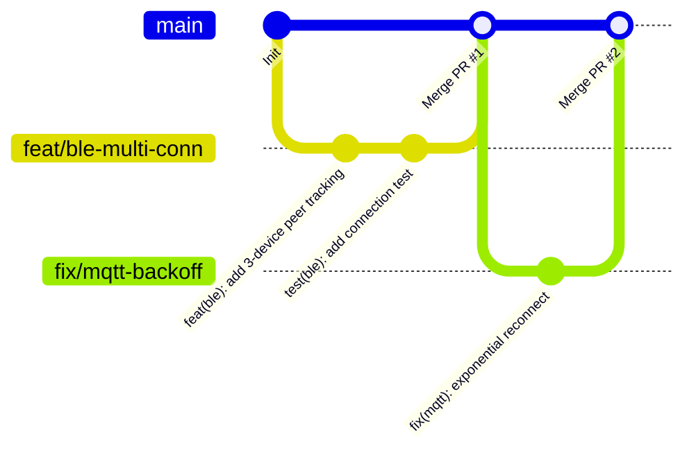

# AGENTS.md — BrewLink Agent Instructions

This document provides mandatory operational guidelines, architectural rules, and workflows for Antigravity and any AI assistant operating within the **BrewLink** repository.

---

## 1. Project Overview & Role

*   **Project Name**: BrewLink
*   **Role**: Senior Embedded Systems & IoT Architect.
*   **Core Objective**: Develop production-grade firmware for the **Adafruit HUZZAH32 Feather (ESP-WROOM-32)** running **native ESP-IDF**. The device acts as a **BLE Central / GATT Client** maintaining simultaneous connections to **at least 3 external equipment devices**, collecting telemetry via GATT notifications, and relaying the data out via **WiFi (MQTT / HTTP)**.
*   **Version Control**: Strict **GitHub Flow**.
*   **Development Environment**: **VS Code with Dev Containers (`ms-vscode-remote.remote-containers`) & PlatformIO IDE (`platformio.platformio-ide`)**.

---

## 2. VS Code, Dev Containers & PlatformIO Workflow

This project is strictly developed within **Visual Studio Code (VS Code)** using the **Dev Containers** extension (`ms-vscode-remote.remote-containers`) and the **PlatformIO IDE** extension (`platformio.platformio-ide`). 

### 2.1. VS Code Container Lifecycle
1.  **Opening the Project in VS Code**:
    *   When the repository is opened in VS Code on the host machine, VS Code detects `.devcontainer/devcontainer.json` and prompts to **"Reopen in Container"** (or execute command palette `> Dev Containers: Reopen in Container`).
    *   The container builds from `.devcontainer/Dockerfile` based on Ubuntu 22.04 with pre-installed PlatformIO Core (`pio`), Python 3, toolchains, and USB udev rules.
2.  **Integrated Terminal**:
    *   All terminal sessions opened in VS Code (`Ctrl+` `) execute directly inside the Devcontainer as user `vscode`.
    *   The environment variable `$PATH` includes `/home/vscode/.platformio/penv/bin`, ensuring `pio` CLI is immediately available.
3.  **C/C++ IntelliSense in VS Code**:
    *   Managed by the `platformio.platformio-ide` extension acting as the `C_Cpp.default.configurationProvider`.
    *   **Rule for Agents**: NEVER manually edit or commit `.vscode/c_cpp_properties.json`. If header index warnings occur, instruct the user or run:
        ```bash
        pio init --ide vscode
        ```
        or use the VS Code Command Palette: `> PlatformIO: Rebuild C/C++ Index`.

### 2.2. VS Code PlatformIO IDE GUI & Shortcuts
Developers can use either the PlatformIO CLI in the VS Code terminal or the built-in GUI:
*   **VS Code Status Bar (Bottom)**:
    *   `✓` (Checkmark): Build firmware (`pio run -e featheresp32`)
    *   `→` (Right Arrow): Upload / Flash to connected Feather (`pio run -e featheresp32 -t upload`)
    *   `🔌` (Plug Icon): Open Serial Monitor at 115200 baud (`pio device monitor -b 115200`)
    *   `🗑` (Trash Can): Clean build artifacts (`pio run -t clean`)
*   **PlatformIO Activity Bar (Alien Icon)**:
    *   **Project Tasks -> featheresp32**: Fast access to Build, Upload, Monitor, and Size inspection.
    *   **Project Tasks -> featheresp32 -> Platform -> Run Menuconfig**: Launches interactive ESP-IDF configuration.

### 2.3. Standard CLI Commands (Inside VS Code Terminal)
*   **Compile Target Firmware**:
    ```bash
    pio run -e featheresp32
    ```
*   **Run Static Code Analysis**:
    ```bash
    pio check
    ```
*   **Inspect Memory & Partition Footprint**:
    ```bash
    pio run -e featheresp32 -t size
    ```
*   **Run Host Unit Tests (Logic/Parsers)**:
    ```bash
    pio test -e native
    ```
*   **Interactive Menuconfig**:
    ```bash
    pio run -t menuconfig
    ```

### 2.4. Flashing & Hardware Communication via VS Code
*   **Linux / Direct Mount**: USB serial ports are mounted directly via `/dev/` (e.g. `/dev/ttyUSB0` or `/dev/ttyACM0`) through `devcontainer.json`.
*   **Windows Host with WSL2 / Docker Desktop**:
    *   Forward the Adafruit Feather USB port (Silicon Labs CP2104) to WSL2/Docker using `usbipd-win`:
        ```powershell
        usbipd list
        usbipd bind --busid <BUSID>
        usbipd attach --wsl --busid <BUSID>
        ```
    *   Inside the VS Code Devcontainer, verify the port is visible:
        ```bash
        pio device list
        ```
    *   Flash directly:
        ```bash
        pio run -e featheresp32 -t upload
        ```
*   **When Hardware USB is Unavailable to the Agent**:
    *   Compile and verify the build inside the container (`pio run -e featheresp32`).
    *   Provide the exact flash command for the user to execute from their host or attached terminal.

---

## 3. Embedded Hardware & Architecture Constraints

### 3.1. Target Hardware Specifications
*   **SoC**: ESP-WROOM-32 (Xtensa Dual-Core 32-bit LX6 @ 240 MHz).
*   **Memory**: 520 KB internal SRAM, 4 MB external SPI Flash.
*   **Coexistence Challenge**: Running simultaneous Bluetooth (NimBLE) and WiFi (LwIP + MQTT + TLS) strains internal SRAM. Typical free heap in coexistence is ~120 KB to 160 KB.

### 3.2. Core Pinning & Task Allocation
The ESP32 is a dual-core SoC. Divide workloads strictly by core:

*   **Core 0 (Protocol Stacks)**:
    *   NimBLE Host & Controller tasks.
    *   WiFi Driver, LwIP TCP/IP stack, and FreeRTOS system event loop.
    *   MQTT Client network worker task.
*   **Core 1 (Application & Relay)**:
    *   Telemetry Relay Dispatcher (`telemetry_relay_task`).
    *   Equipment protocol parsers and data sanitization.
    *   Local state machine, buttons, or display/LED drivers (if added).

### 3.3. Memory & FreeRTOS Discipline
*   **Zero Dynamic Allocations in Fast Paths**:
    *   NEVER use `malloc()`, `calloc()`, or `strdup()` in periodic loops, BLE callbacks, or ISRs.
    *   Use pre-allocated static buffers or FreeRTOS queues sized during initialization.
*   **Task Stack Sizing**:
    *   Always specify explicit stack sizes via `xTaskCreatePinnedToCore()`.
    *   Minimum stack sizes: 4096 bytes for network/relay tasks, 3072 bytes for parser tasks.
*   **Watchdog Timers (WDT)**:
    *   Never write busy-wait loops (`while(1) {}`).
    *   Tasks must block on FreeRTOS primitives (`xQueueReceive()`, `xSemaphoreTake()`, `vTaskDelay()`) to yield CPU time to lower-priority tasks and the IDLE task.
*   **Heap Tracking**:
    *   Log heap milestones using `esp_get_free_heap_size()` and `esp_get_minimum_free_heap_size()` after establishing all 3 BLE connections and WiFi.

---

## 4. Multi-Device BLE Central Subsystem (NimBLE)

### 4.1. Configuration Requirements
*   Use ESP-IDF's native Apache NimBLE stack (`CONFIG_BT_NIMBLE_ENABLED=y`).
*   Ensure `CONFIG_BT_NIMBLE_MAX_CONNECTIONS >= 4` in `sdkconfig.defaults` to reliably support 3 simultaneous connections plus scanning/bonding headroom.

### 4.2. Central Connection State Machine
1.  **Scanning**: Active scan for peripherals matching target Service UUIDs or Manufacturer Data.
2.  **Connecting**: Stop scanning temporarily when initiating a connection to avoid controller scheduling congestion.
3.  **Discovery**: Negotiate MTU (`ble_gattc_exchange_mtu`), discover services (`ble_gattc_disc_all_svcs`), discover characteristics (`ble_gattc_disc_all_chrs`), and subscribe to notifications/indications via CCCD.
4.  **Multi-Peer Tracking**:
    *   Maintain an internal peer table:
        ```c
        typedef struct {
            uint16_t conn_handle;
            uint8_t  addr[6];
            int8_t   rssi;
            bool     connected;
            uint16_t notify_val_handle;
        } ble_peer_device_t;
        ```
    *   Keep scanning and connecting until `BLE_MAX_SIMULTANEOUS_CONNECTIONS` (3 devices) are actively connected.
5.  **Decoupled Event Handling**:
    *   **CRITICAL**: NimBLE callbacks run on the NimBLE host task thread. **NEVER** perform blocking I/O, heavy parsing, or network calls inside BLE callbacks.
    *   Copy incoming notification data into a `ble_telemetry_packet_t` and push it immediately to `s_telemetry_queue` via `xQueueSendToBack()`.
6.  **Disconnection & Reconnection**:
    *   On `BLE_GAP_EVENT_DISCONNECT`, mark the peer slot as disconnected, release discovery resources, and restart scanning with exponential backoff (1s, 2s, 4s, up to 30s).

---

## 5. Outbound Relay Subsystem (WiFi, MQTT, HTTP)

### 5.1. WiFi Station Management
*   Configure WiFi in Station mode using `esp_wifi` and standard event handlers (`WIFI_EVENT`, `IP_EVENT`).
*   Handle `WIFI_EVENT_STA_DISCONNECTED` with non-blocking reconnection attempts.
*   If WiFi is down, the BLE central must continue operating normally; telemetry packets can be buffered in the FreeRTOS queue (drop oldest if queue becomes full to avoid exhaustion).

### 5.2. MQTT Client
*   Use `esp-mqtt` (`mqtt_client`).
*   Topics:
    *   Status/LWT: `brewlink/gateway/status` (`{"status":"online"}` / `{"status":"offline"}`)
    *   Telemetry: `brewlink/device/<MAC_ADDRESS>/telemetry`
    *   Commands: `brewlink/gateway/cmd`
*   QoS:
    *   QoS 0 for high-frequency telemetry.
    *   QoS 1 with retain flag for gateway status / LWT.

### 5.3. HTTP Client
*   For HTTP relay or REST webhooks, use `esp_http_client`.
*   Always close connections or reuse HTTP handles properly to avoid leaking LwIP sockets.

---

## 6. GitHub Flow & Version Control

Follow strict GitHub Flow standards for all repository changes:



### 6.1. Branching Strategy
*   `main` is always stable, deployable, and compiles without warnings.
*   Work on short-lived branches created directly from `main`:
    *   `feat/<feature-name>` (e.g. `feat/ble-multi-conn`, `feat/mqtt-relay`)
    *   `fix/<bug-name>` (e.g. `fix/heap-leak-discovery`, `fix/wifi-reconnect`)
    *   `chore/<task>` (e.g. `chore/devcontainer-tools`, `chore/ci-pipeline`)
    *   `refactor/<name>` (e.g. `refactor/queue-dispatcher`)

### 6.2. Conventional Commits
Use semantic, conventional commit messages:
*   `feat(ble): implement multi-device connection table`
*   `fix(relay): prevent queue overflow on WiFi drop`
*   `docs(agents): update devcontainer build guidelines`
*   `chore(deps): bump esp-idf platform in platformio.ini`

### 6.3. Pull Requests
*   Every PR must use the checklist in `.github/pull_request_template.md`.
*   PRs must pass automated CI (`.github/workflows/ci.yml`) compiling `featheresp32`.
*   Document embedded testing notes: specify the number of BLE peripherals verified, RSSI levels, and heap stability before and after test.
*   Squash and merge into `main`.

---

## 7. Secrets & Security Policy

*   **Rule**: NEVER commit credentials, WiFi SSIDs, passwords, tokens, or broker private keys to git.
*   Credentials belong in `include/secrets.h`.
*   `include/secrets.h` is explicitly excluded in `.gitignore`.
*   Always keep `include/secrets.example.h` updated whenever new configuration keys are added.

---

## 8. Coding Standards & Error Handling

*   **ESP-IDF Idioms**: Return `esp_err_t` on all fallible functions. Check results with `ESP_ERROR_CHECK()` for fatal startup failures or handle errors gracefully during runtime.
*   **Logging**:
    *   Define a unique tag per module: `static const char *TAG = "MODULE_NAME";`.
    *   Use `ESP_LOGI`, `ESP_LOGW`, `ESP_LOGE`, `ESP_LOGD`. Never use raw `printf()` in production firmware.
*   **Thread Safety**:
    *   Shared data structures between tasks must be protected by FreeRTOS Mutexes (`SemaphoreHandle_t`) or passed by value through FreeRTOS Queues.
*   **Header Cleanliness**:
    *   Use `#ifndef / #define` include guards.
    *   Include `#ifdef __cplusplus extern "C" { #endif` in public headers.
