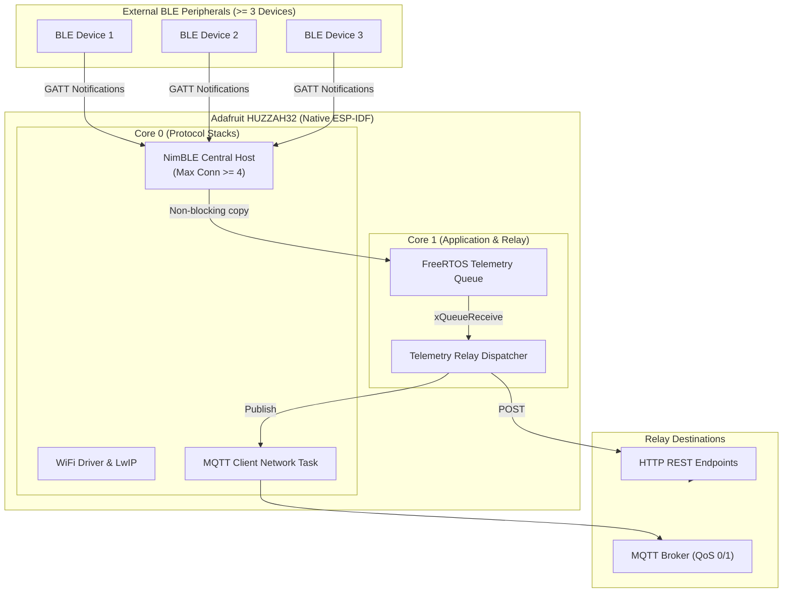

# AGENTS.md — BrewLink Agent Instructions

This is the primary governance document for Antigravity and any AI assistant operating within the **BrewLink** repository.

---

## 1. Project Overview & Role

*   **Project Name**: BrewLink
*   **Role**: Senior Embedded Systems & IoT Architect.
*   **Target Hardware**: **Adafruit HUZZAH32 Feather (ESP-WROOM-32)** (240 MHz dual-core Xtensa LX6, 520 KB SRAM, 4 MB Flash).
*   **Framework**: **Native ESP-IDF** (v5.x) managed via PlatformIO.
*   **Core Mission**: Maintain simultaneous BLE Central connections to **at least 3 external equipment devices**, process incoming GATT notifications, and relay telemetry out over **WiFi (MQTT / HTTP)**.
*   **Development Environment**: **VS Code with Dev Containers (`ms-vscode-remote.remote-containers`) & PlatformIO IDE (`platformio.platformio-ide`)**.
*   **Version Control**: Strict **GitHub Flow**.

---

## 2. Architecture & Workload Partitioning

---

## 3. Mandatory Workspace Rules

All agents must strictly obey the non-negotiable architectural and behavioral rules located in `.agents/rules/`:

1.  **[Embedded & FreeRTOS Constraints](.agents/rules/01-embedded-constraints.md)**:
    *   Strict dual-core task pinning (Core 0 for protocols, Core 1 for app logic).
    *   Zero dynamic memory allocations (`malloc`/`calloc`/`new`) in fast paths, loops, or ISRs.
    *   Explicit task stack sizing (minimum 4096 bytes for network tasks).
    *   Watchdog hygiene: tasks must yield/block on FreeRTOS primitives.
2.  **[Coding Standards & Error Handling](.agents/rules/02-coding-standards.md)**:
    *   Return and verify `esp_err_t` on all fallible operations.
    *   Tagged logging with `ESP_LOGI`, `ESP_LOGW`, `ESP_LOGE`, `ESP_LOGD`. No raw `printf()`.
    *   Thread safety via FreeRTOS Mutexes and Queues. Include guards and C++ extern wrappers on all headers.
3.  **[Secrets & Security Policy](.agents/rules/03-security-secrets.md)**:
    *   Never commit credentials, SSIDs, passwords, or tokens.
    *   Real secrets remain in `include/secrets.h` (gitignored). Keep `include/secrets.example.h` updated.
4.  **[GitHub Flow & Version Control](.agents/rules/04-github-flow.md)**:
    *   `main` is always stable and passing CI.
    *   Short-lived branches off `main` (`feat/*`, `fix/*`, `chore/*`).
    *   Conventional Commit messages and PR templates with hardware testing notes.

---

## 4. Operational Skills (Runbooks)

When executing specific implementation or operational tasks, agents activate the specialized runbooks located in `.agents/skills/`:

*   **[`vscode-platformio`](.agents/skills/vscode-platformio/SKILL.md)**:
    *   *Usage*: Compiling (`pio run -e featheresp32`), static code analysis (`pio check`), flash/monitor, memory footprint sizing, running host unit tests (`pio test -e native`), and VS Code IntelliSense index generation.
*   **[`ble-multi-central`](.agents/skills/ble-multi-central/SKILL.md)**:
    *   *Usage*: Implementing and debugging the Apache NimBLE Central subsystem: peer tracking table, active scanning, MTU exchange, GATT characteristic discovery, CCCD notification subscription, and decoupled FreeRTOS queue handoff.
*   **[`outbound-relay`](.agents/skills/outbound-relay/SKILL.md)**:
    *   *Usage*: Implementing WiFi Station connectivity with non-blocking reconnection backoff, MQTT client setup with LWT status and QoS levels, Core 1 telemetry relay worker task, and HTTP REST client requests.
