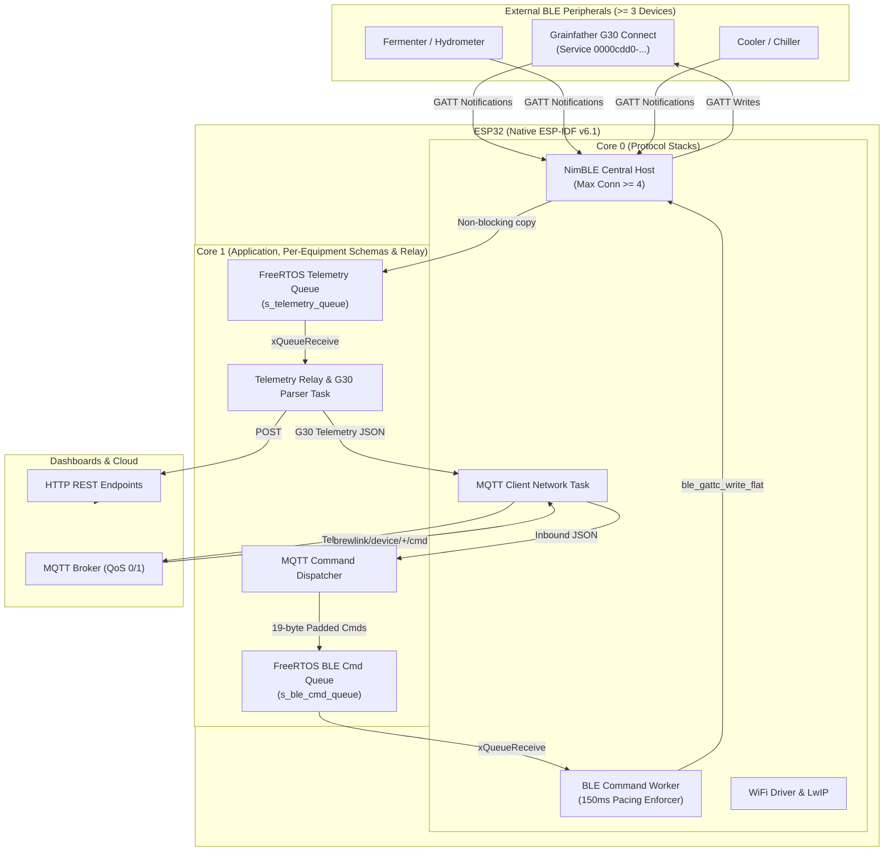

# AGENTS.md — BrewLink Agent Instructions

This is the primary governance document for Antigravity and any AI assistant operating within the **BrewLink** repository.

---

## 1. Project Overview & Role

*   **Project Name**: BrewLink
*   **Role**: Senior Embedded Systems & IoT Architect.
*   **Target Hardware**: **ESP32 (ESP-WROOM-32 / DevKitC / Adafruit HUZZAH32)** (240 MHz dual-core Xtensa LX6, 520 KB SRAM, 4 MB Flash).
*   **Framework**: **Native ESP-IDF** (v6.1) managed via PlatformIO.
*   **Core Mission**: Maintain simultaneous BLE Central connections to **at least 3 external equipment devices** (Boilers, Fermenters, Coolers/Heaters), provide bidirectional control (read temperatures/states, write pump/heating controls, transfer brew recipes), map device telemetry to per-equipment data schemas (one schema per supported equipment model), and relay telemetry out over **WiFi (MQTT / HTTP)**. Initial scope focuses on the **Grainfather G30 Connect**, architected for multi-equipment expansion.
*   **Development Environment**: **VS Code with Dev Containers (`ms-vscode-remote.remote-containers`) & PlatformIO IDE (`platformio.platformio-ide`)**.
*   **Version Control**: Strict **GitHub Flow** (never push to `main`, never force push, new branches from updated `main`).

---

## 2. Architecture & Workload Partitioning

---

## 3. Mandatory Workspace Rules

All agents must strictly obey the non-negotiable architectural and behavioral rules located in `.agents/rules/`:

1.  **[Embedded & FreeRTOS Constraints](.agents/rules/01-embedded-constraints.md)**:
    *   Mandatory framework: Native ESP-IDF v6.1.
    *   Strict dual-core task pinning (Core 0 for protocols, Core 1 for app logic).
    *   Zero dynamic memory allocations (`malloc`/`calloc`/`new`) in fast paths, loops, or ISRs.
    *   Explicit task stack sizing (minimum 4096 bytes for network tasks).
    *   Watchdog hygiene: tasks must yield/block on FreeRTOS primitives.
2.  **[Coding Standards & Error Handling](.agents/rules/02-coding-standards.md)**:
    *   Return and verify `esp_err_t` on all fallible operations.
    *   Tagged logging with `ESP_LOGI`, `ESP_LOGW`, `ESP_LOGE`, `ESP_LOGD`. No raw `printf()`.
    *   Thread safety via FreeRTOS Mutexes and Queues. Include guards and C++ extern wrappers on all headers.
    *   **Post-Edit Build Verification**: Always run `devcontainer exec pio run -e esp32dev -t build` after finishing ESP code edits and fix any build errors.
3.  **[Secrets & Security Policy](.agents/rules/03-security-secrets.md)**:
    *   Never commit credentials, SSIDs, passwords, or tokens.
    *   Real secrets remain in `include/secrets.h` (gitignored). Keep `include/secrets.example.h` updated.
4.  **[GitHub Flow & Version Control](.agents/rules/04-github-flow.md)**:
    *   **Never push to `main`**; all changes reach `main` exclusively via Pull Requests.
    *   **Never force push** (`--force` or `--force-with-lease`).
    *   **Always start a new session/feature in a new branch from updated `main`** (`git checkout main && git pull origin main`) unless stated otherwise.
    *   `main` is always stable and passing CI.
    *   Short-lived branches off `main` (`feat/*`, `fix/*`, `chore/*`).
    *   Conventional Commit messages and PR templates with hardware testing notes.
5.  **[Host Environment Protection & Zero-Installation Policy](.agents/rules/05-host-environment-protection.md)**:
    *   **NEVER install software on the host computer** (no frameworks, runtimes, package manager installs, compilers, drivers, or addons).
    *   All compilation and toolchains reside inside the VS Code Devcontainer (`devcontainer exec ...`).
    *   If a tool or framework is missing and required to proceed, **immediately prompt the user** with instructions to install it manually and await confirmation.
6.  **[Per-Equipment Schemas](.agents/rules/06-per-equipment-schemas.md)**:
    *   **No shared schemas.** Every supported equipment model has its own schema header (`include/<model>_schema.h`, e.g. `g30_schema.h`) with model-prefixed types.
    *   A boiler model like the G30 is its own schema; a fermenter model added later gets its own schema, etc.
    *   **Adding new equipment requires adding its own schema** (plus driver, telemetry mapping, tests, and doc updates).

---

## 4. Operational Skills (Runbooks)

When executing specific implementation or operational tasks, agents activate the specialized runbooks located in `.agents/skills/`:

*   **[`vscode-platformio`](.agents/skills/vscode-platformio/SKILL.md)**:
    *   *Usage*: Compiling (`pio run -e esp32dev` or `devcontainer exec pio run -e esp32dev -t build`), static code analysis (`pio check`), flash/monitor, memory footprint sizing, running host unit tests (`pio test -e native`), and VS Code IntelliSense index generation.
*   **[`ble-multi-central`](.agents/skills/ble-multi-central/SKILL.md)**:
    *   *Usage*: Implementing and debugging the Apache NimBLE Central subsystem: peer tracking table, active scanning, MTU exchange, GATT characteristic discovery, CCCD notification subscription, and decoupled FreeRTOS queue handoff.
*   **[`outbound-relay`](.agents/skills/outbound-relay/SKILL.md)**:
    *   *Usage*: Implementing WiFi Station connectivity with non-blocking reconnection backoff, MQTT client setup with LWT status and QoS levels, Core 1 telemetry relay worker task, and HTTP REST client requests.
*   **[`grainfather-g30-ble`](.agents/skills/grainfather-g30-ble/SKILL.md)**:
    *   *Usage*: Communicating with the Grainfather G30 Connect controller over BLE: USR-BLE UART service and characteristics, strict 19-byte ASCII space-padded command formatting, pacing delay enforcement (150 ms), notification parsing (`X`, `Y`, `T`, `W`, `I`, `C`), recipe transfer sequencing (`R` command, boil additions, mash steps), and G30-specific schema mapping (`g30_schema.h`).
*   **[`brewing-recipe-schemas`](.agents/skills/brewing-recipe-schemas/SKILL.md)**:
    *   *Usage*: Parsing, validating, transforming, and crosswalk conversions between BeerXML 1.0, BeerJSON, and BrewLink G30 recipe schema.
*   **[`brewlink-external-client`](.agents/skills/brewlink-external-client/SKILL.md)**:
    *   *Usage*: Connecting external systems, recipe managers, and dashboards to BrewLink via WebSockets (`/ws`), MQTT (with HMAC-SHA256 signature verification), and HTTP REST (`/api/equipment/*`), including 6-digit PIN pairing, API token verification, fail-fast offline error handling, and the per-equipment schemas (state, telemetry, controls, recipes) of every supported equipment model.
