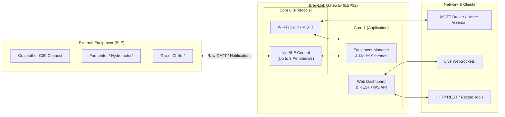

# BrewLink

BrewLink is an open-source embedded IoT gateway for homebrewing systems running on an ESP32. It bridges Bluetooth Low Energy (BLE) brewing controllers and sensors to your local Wi-Fi network, home automation platforms (like Home Assistant), and brewing software.

---

## Architecture Overview


*\*Fermenter and chiller profiles architected for multi-equipment expansion.*

---

## Core Features

* **Multi-Device BLE Central**: Maintains simultaneous BLE Central connections to up to 3 brewing peripherals with background scanning, automatic service discovery, and automatic reconnection.
* **Grainfather G30 Connect Integration**: Full bidirectional control including target temperature, heating power percentage, recirculation pump toggling, mash/boil timers, prompt acknowledgments, and automated multi-step recipe transfer.
* **Per-Equipment Schemas**: Strict model-specific schemas (such as `include/g30_schema.h`) ensure full fidelity for hardware features, state machines, and commands without lossy generic abstractions.
* **Flexible Protocol Relay**:
  * **MQTT**: Publishes real-time telemetry and listens for commands with configurable QoS and Last Will and Testament (LWT) gateway status reporting.
  * **WebSockets**: Streams live, low-latency equipment telemetry directly to web browsers and external dashboards (`/ws`).
  * **REST API**: Provides HTTP endpoints (`/api/equipment/*`) to query status, pair clients, control hardware, and upload recipes.
* **Zero-Friction Setup & Pairing**:
  * **Captive Portal**: Boots into a Wi-Fi setup Access Point (`BrewLink-Setup`) to configure local Wi-Fi and MQTT credentials without external tools.
  * **Embedded Web Dashboard**: Self-contained web interface to monitor sessions, view live RSSI and connection statuses, and control equipment.
  * **Push-Button Pairing**: Simple 3-second hold of the physical `BOOT` button activates pairing mode with automatic UDP (`255.255.255.255:53540`) and MQTT discovery beacons.
  * **Secure Authentication**: HMAC-SHA256 and token-based API authentication for external clients.

---

## Dual-Core Workload Partitioning

BrewLink leverages the ESP32 dual-core Xtensa processor via FreeRTOS:
* **Core 0 (Protocol Stacks)**: NimBLE Central host, BLE command pacing worker (150 ms inter-command delay enforcer), Wi-Fi driver, LwIP, and MQTT client network tasks.
* **Core 1 (Application & Relay)**: Non-blocking telemetry queue consumer, per-equipment state parsing, command dispatching, HTTP web server, and client authentication.

---

## Getting Started

### Hardware Requirements
* **Microcontroller**: ESP32 development board (ESP-WROOM-32, ESP32-DevKitC, Adafruit HUZZAH32, or compatible).
* **Peripherals**: Grainfather G30 Connect controller (or supported BLE brewing hardware).

### Development Environment
BrewLink is developed using **PlatformIO** and **Native ESP-IDF v6.1**. The recommended workflow is using the pre-configured VS Code Dev Container.

1. **Clone the repository**:
   ```bash
   git clone https://github.com/JakeMannen/BrewLink.git
   cd BrewLink
   ```

2. **Open in VS Code Dev Container**:
   * Open the project folder in VS Code.
   * Click **Reopen in Container** when prompted (or open the Command Palette and run `Dev Containers: Reopen in Container`).

3. **Configure Secrets**:
   Copy the example secrets file and adjust credentials if needed:
   ```bash
   cp include/secrets.example.h include/secrets.h
   ```

4. **Build the Firmware**:
   ```bash
   pio run -e esp32dev
   ```

5. **Run Host Unit Tests**:
   ```bash
   pio test -e native
   ```

6. **Flash & Monitor**:
   ```bash
   pio run -e esp32dev -t upload
   pio device monitor -b 115200
   ```

---

## Repository Structure

```text
├── .agents/             # Agent rules and operational skills (BLE, schemas, external clients)
├── .devcontainer/       # Dev container configuration with ESP-IDF & PlatformIO
├── include/             # Public C/C++ header files & per-equipment schemas
│   ├── g30_schema.h     # Grainfather G30 schema & command definitions
│   ├── equipment_*.h    # Equipment manager & slot tracking definitions
│   └── secrets.example.h# Template for Wi-Fi and MQTT credentials
├── src/                 # ESP-IDF firmware source code (C)
├── test/                # Unity host unit tests (native target)
├── platformio.ini       # PlatformIO build configurations
└── partitions.csv       # ESP32 flash partition table
```

---

## Documentation & Skills

For deep-dive documentation on specific subsystems, refer to the runbooks in `.agents/skills/`:
* [BLE Multi-Central Subsystem](.agents/skills/ble-multi-central/SKILL.md)
* [Grainfather G30 Protocol & Schema](.agents/skills/grainfather-g30-ble/SKILL.md)
* [External Client Integration Guide](.agents/skills/brewlink-external-client/SKILL.md)
* [Outbound Network Relay (MQTT/HTTP)](.agents/skills/outbound-relay/SKILL.md)
* [Brewing Recipe Schemas & Crosswalk](.agents/skills/brewing-recipe-schemas/SKILL.md)

---

## License

This project is licensed under the [MIT License](LICENSE).
